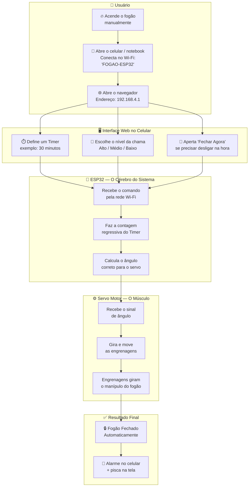
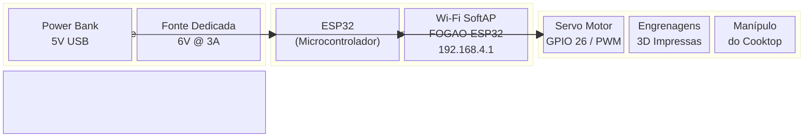
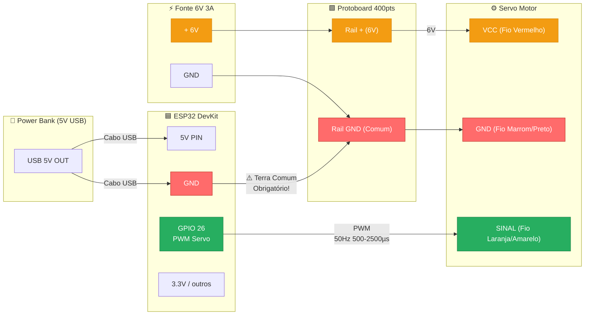
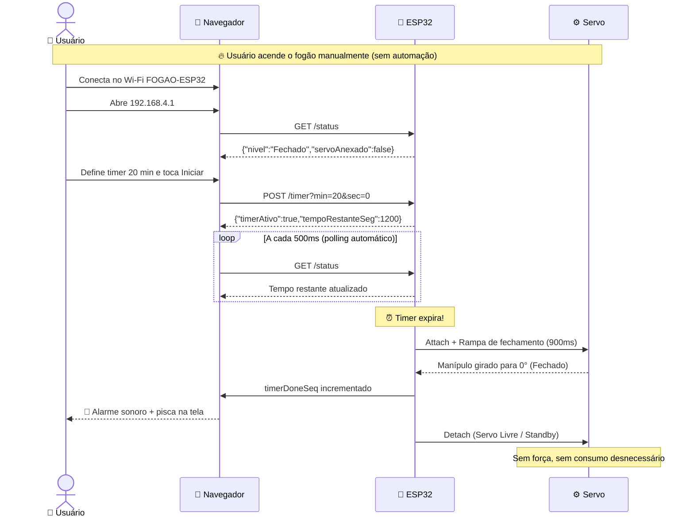
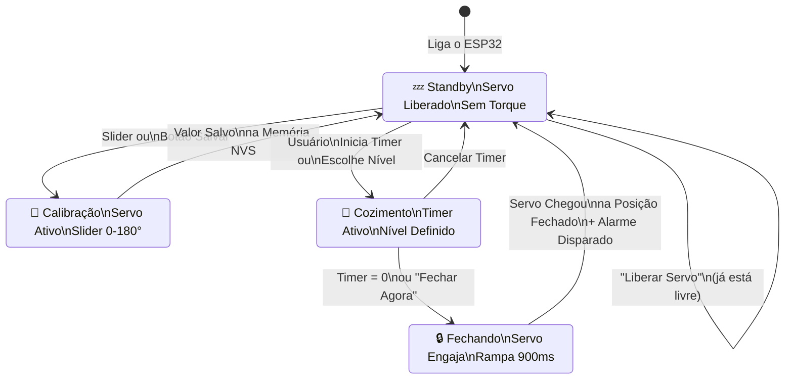

# 📊 Diagramas do Projeto — FogãoServoWeb

---

## 1. Diagrama para Leigos — "Como funciona o sistema?"

---

## 2. Diagrama de Blocos — "Arquitetura do Sistema"

---

## 3. Diagrama Elétrico — "Ligação dos Componentes"

---

## 4. Diagrama de Sequência — "Uma sessão de cozimento completa"

---

## 5. Resumo Visual dos Estados do Sistema

---

> [!NOTE]
> **Próximos refinamentos previstos:** adicionar o conjunto de engrenagens 3D (pinhão + coroa) no diagrama mecânico e o diagrama de montagem física no cooktop após definição dos parâmetros das engrenagens.
