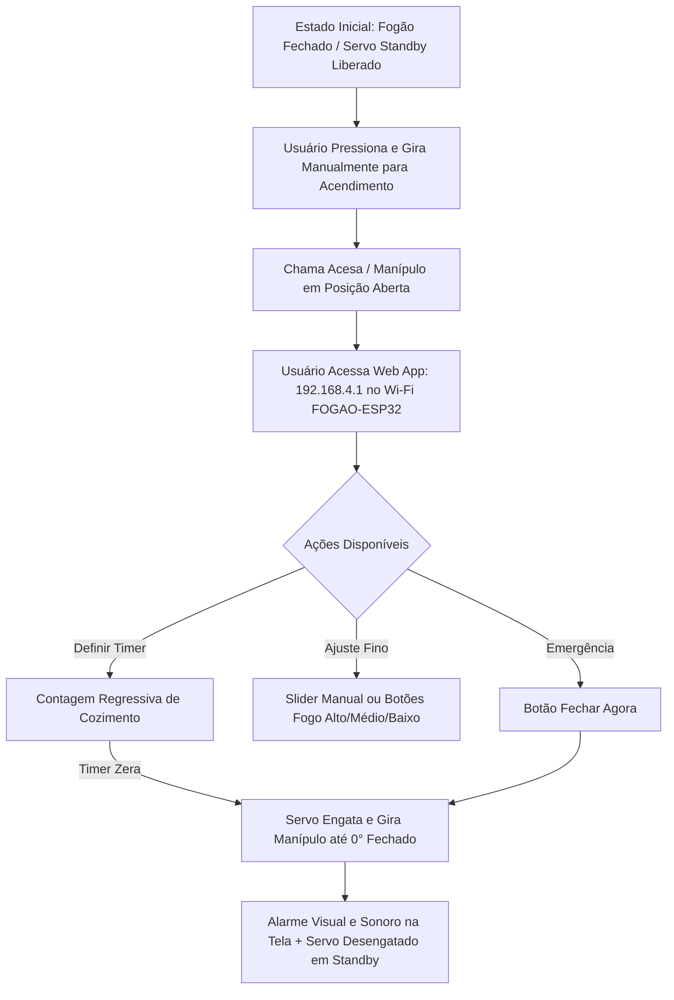

# 📚 Base de Conhecimento Central — TCC Automação Industrial: FogãoServoWeb

Documento vivo de consolidação técnica, contexto de engenharia, requisitos e roadmap de desenvolvimento.

---

## 1. Identificação do Projeto e Aluno

* **Área / Curso:** Automação Industrial
* **Tema:** Sistema Mechatrônico / IoT Retrofit para Automação e Segurança de Fogão a Gás (Cooktop).
* **Objetivo Geral:** Prover segurança contra esquecimento de chamas acesas, temporização de cocção e controle angular de chama através de manípulo automatizado com ESP32 e Servo Motor, sem alterar a estrutura interna do eletrodoméstico.

---

## 2. Arquitetura Operacional e Fluxo de Uso

* **Premissa de Engenharia:**
  * O acendimento ("apertar e girar") é **manual pelo usuário** por segurança e simplicidade mecânica.
  * O sistema entra em ação para **manutenção de nível de chama, temporização e fechamento automático**.
  * **Auto-Release Integral (`releaseServo` / `detach`):** O servo permanece livre (desanexado do PWM) em repouso e **se auto-libera imediatamente após qualquer comando** (botões de chama, slider ou fechamento). Isso garante que o manuseio manual seja fluido a qualquer momento, economiza energia e protege as engrenagens e enrolamentos do motor MG90S contra sobreaquecimento.

---

## 3. Arquitetura Elétrica e Hardware

| Componente | Especificação | Função / Detalhe de Conexão |
| :--- | :--- | :--- |
| **Microcontrolador** | ESP32 DOIT DevKit V1 (30 pinos) | Central de processamento, SoftAP Wi-Fi (`FOGAO-ESP32`), Web Server HTTP, lógica de temporização e modulação PWM do servo no pino **D26**. |
| **Alimentação ESP32** | Power Bank USB (5V) | Alimentação isolada e estável conectada na porta Micro-USB integrada da placa. |
| **Atuador** | Micro Servo **MG90S** (Metal Gear) | Torque angular de ~2,2 kgf.cm a 6V com engrenagens metálicas. Sinal PWM no pino **D26 (GPIO 26)**. |
| **Alimentação do Servo** | Fonte dedicada **6V @ 3A** | Garante torque máximo do MG90S e estabilidade total sem brownouts. |
| **Interconexão** | Protoboard 400 pontos | Barramento comum de **GND (Terra Compartilhado Obrigatório entre Fonte 6V e ESP32)** e distribuição de sinal. |

> [!IMPORTANT]
> **Regra de Ouro Elétrica:** O terminal negativo (GND) da fonte de 6V do servo **deve estar conectado ao pino GND do ESP32**. O terminal positivo (+6V) vai exclusivamente ao VCC (fio vermelho) do servo, sem tocar o pino 5V/3.3V do ESP32.

---

## 4. Estrutura de Firmware e Software

* **Linguagem:** C++ (Arduino Framework / ESP32 Core).
* **Armazenamento Não-Volátil:** Biblioteca `Preferences.h` gravando calibrações de ângulos na memória NVS (`fechado`, `alto`, `medio`, `baixo`).
* **Suavização Cinemática:** Rampa de aceleração (`rampActive` com tempo padrão de 900ms) que calcula a interpolação linear/senoidal da posição para fechamento suave sem trancos.
* **Interface Web Embutida:** 
  * Totalmente armazenada na memória flash (`PROGMEM`).
  * Atualização assíncrona com `fetch` e polling em tempo real.
  * Feedback sonoro usando `Web Audio API` (não necessita de buzzer físico no primeiro momento).

---

## 5. Engenharia Mecânica e Próximo Passo (Engrenagens 3D)

* **Peça Atual:** Acoplamento 3D (`Corpo5`) já impresso e validado dimensionalmente no eixo do cooktop.
* **Próxima Etapa:** Desenvolvimento do conjunto de **par de engrenagens 3D**:
  1. **Engrenagem Motora (Pinhão):** Acoplada ao eixo estriado do servo motor.
  2. **Engrenagem Movida (Coroa):** Acoplada à peça do manípulo (`Corpo5`).
  3. **Objetivos do Par de Engrenagens:**
     * Ganho de torque mecânico através de relação de transmissão ($i = Z_2 / Z_1$).
     * Compatibilização da faixa angular de giro do manípulo com os 180° do servo.
     * Ajuste de folga (*backlash*) e posicionamento físico dos eixos no cooktop.

---

## 6. Registro de Decisões e Padrões

1. **Automação Industrial Focus:** O projeto prioriza robustez operacional, separação galvânica/elétrica de potência e controle, facilidade de calibração em campo e segurança de desligamento.
2. **Memória de Estado:** As calibrações de bancada são salvas direto na memória não-volátil do ESP32 via interface web.
